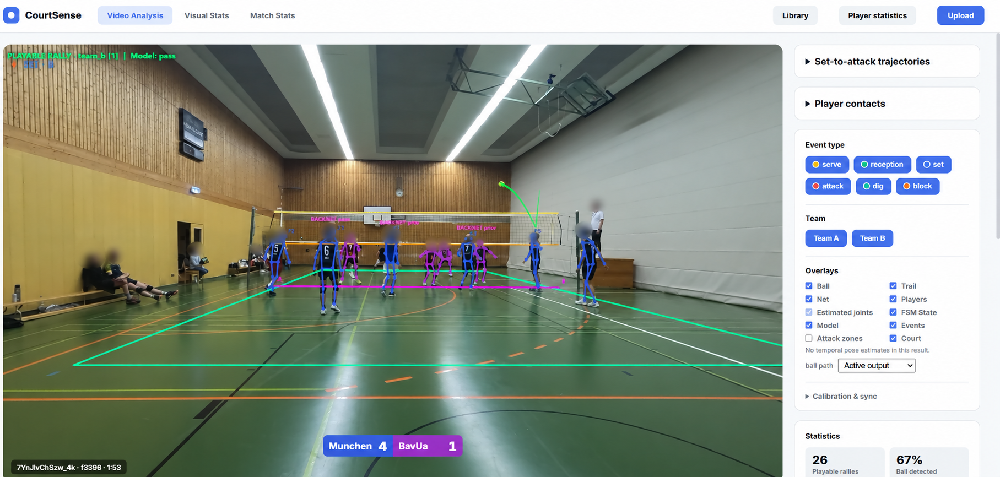

# Volleystat

**Offline volleyball analytics for fixed-camera video, with the CourtSense viewer.**

Volleystat turns match recordings into ball trajectories, tracked player poses, contact events, rallies and reviewable statistics. Its goal is to make games easier to explore: find a rally, follow a set into an attack, or inspect one player's contacts without scrubbing through an entire recording.

Analysis runs locally and prioritizes accuracy over real-time speed. The pipeline targets 4K footage from a stationary camera; CourtSense is its browser-based review interface.



*CourtSense during match review. Faces blurred for privacy.*

[Getting started](#getting-started) · [Components](#components) · [Documentation](#documentation)

## What you can do

- **Follow the ball.** Detect candidates, select the active match ball, remove static false positives and smooth its trajectory. Optional gap reconstruction preserves the distinction between observed and estimated positions.
- **Review players and contacts.** Track 17-keypoint poses, assign court sides, discover a player roster and inspect proposed contact authors. Select a player to highlight their skeleton and seek to their contacts.
- **Navigate rallies.** Browse playable rallies, service attempts and typed contact events. Inspect set-to-attack trajectories with zone and setter filters.
- **Explore match statistics.** View serve, reception and attack maps, contact logs, team summaries and per-player attack/reception outcomes where evidence is available.
- **Calibrate and correct.** Preview a source frame, edit court and net geometry, and save contact-author corrections separately from model predictions.
- **Reuse analysis.** Open saved results from the library, replay processing from cached model outputs and export JSON or an annotated video.

## Components

| Component | Role |
|---|---|
| **Analysis pipeline** — `analyze_video.py`, `src/pipeline/` | Orchestrates detection, tracking, offline passes and result export. |
| **Ball and player vision** — `src/detection/`, `src/tracking/` | YOLO ball detection; YOLO11m-pose + ByteTrack; trajectory selection, smoothing and optional reconstruction. |
| **Court and net geometry** | Perspective calibration and net references for court filtering, side assignment and overlays; manual editing and automatic detection paths. |
| **Events and game logic** — `action_recognition/rally_spotting/`, `src/tracking/` | Rally/contact FSM, optional dense contact spotter, contact-side proposals and player-contact attribution. A separate sequence model supplies a four-class event overlay. |
| **Player identity** | Frozen OSNet appearance features group tracklets into a roster. Default scope is six players on the near side; ambiguous identities stay unknown. |
| **CourtSense viewer** — `viewer.py`, `viewer/`, `src/viewer_app/` | Local Flask app for uploads, calibration, video overlays, charts, match tables, player statistics and saved-result browsing. |
| **Annotation and research tools** — `action_recognition/annotator/`, `scripts/` | Human review, dataset export, model training and evaluation, kept separate from ordinary analysis. |
| **Cache and model registry** — `src/models/`, `configs/model_registry.json` | Reuse compatible inference outputs and record model versions/checksums in each result. |

```text
Video + court calibration
  → ball detection and player poses
  → trajectory cleanup, court filtering and game logic
  → events, roster identity and contact attribution
  → JSON results → CourtSense viewer / optional video export
```

## Getting started

### 1. Prepare the environment

Use Python 3.11. An NVIDIA GPU is recommended for 4K analysis; the reference workstation uses an RTX 5070 Ti 16 GB and 32 GB RAM. The commands below use PowerShell from the repository root and the tested PyTorch 2.7.1 / CUDA 12.8 build.

```powershell
py -3.11 -m venv volley_env_311
./volley_env_311/Scripts/Activate.ps1
python -m pip install --upgrade pip
python -m pip install torch==2.7.1 torchvision==0.22.1 --index-url https://download.pytorch.org/whl/cu128
python -m pip install -r requirements.txt
python -m pip install flask flask-cors pyarrow
```

**Model assets are separate from the source checkout.** Local weights, videos, caches and results are gitignored. Provision the weights listed in [the model configuration](configs/model_registry.json); a running local MLflow registry can supply registered models, otherwise configured local fallbacks are used. The pinned player-identity bundle has an installer:

```powershell
python scripts/models/install_player_reid.py
```

See [model setup](docs/usage.md#model-assets) for checks and optional stages. Once assets are installed, routine analysis runs locally without runtime model downloads.

### 2. Start CourtSense

```powershell
python viewer.py
```

Open [localhost:5050](http://localhost:5050). Choose **Upload**, provide a local video path or drop a file, then open **Preview and edit court & net**. Adjust geometry for the camera and start analysis. Dropped files are copied into local `data/uploads/`.

Saved analyses appear in the [results library](http://localhost:5050/library). Each result offers **Video Analysis**, **Visual Stats**, **Match Stats** and **Player statistics**.

### 3. Or analyze from the CLI

Calibrate each fixed camera placement, then normalize the calibration into the pipeline's corner order:

```powershell
python scripts/interactive_court_calibration.py --input "C:/path/game.webm" --output court_calibration_raw.json
python scripts/normalize_calibration.py --input court_calibration_raw.json --output court_calibration_game.json

python analyze_video.py `
  --video "C:/path/game.webm" `
  --calibration court_calibration_game.json `
  --output results/game_v1
```

Use a fresh output directory for each run. Review court and net alignment before relying on derived statistics. The [usage guide](docs/usage.md) covers contact spotting, match configuration, cache-only replay and video export; `python analyze_video.py --help` lists supported options.

## Results

For `game.webm` analyzed into `results/game_v1/`:

| File | Contents |
|---|---|
| `game_stats.json` | Rallies, events, aggregate analytics and model/cache provenance. |
| `game_annotations.json` | Frame-level ball positions, player poses, identities, geometry and event data for the viewer. |
| `game_analyzed.mp4` | Annotated video, produced only with `--render-video`. |

Default output is JSON plus interactive overlays on the original video. Keep the original recording accessible to the viewer.

## Current scope and limits

- **Camera setup matters.** Calibration is required per placement. Current geometry is 2D image/court geometry; displayed attack height is an approximation, not a measured 3D trajectory.
- **Predictions need review.** Full-match identity and contact-author accuracy with automatic rosters have not been established. Unknown players and unresolved outcomes remain explicit.
- **Event paths differ.** Viewer analyses enable the configured contact spotter when its checkpoint is available. CLI analyses enable it with `--contact-spotter`; otherwise contacts/rallies use the FSM. With spotting enabled, score and attack heatmap remain FSM-derived.
- **Match context needs input.** Configure warm-up/non-game intervals, set boundaries and team-side switches for the recording. The contact spotter does not distinguish warm-up from match play.
- **Estimates retain provenance.** Ball-gap reconstruction is off by default. Missing off-camera ball positions remain missing; reconstructed positions are derived data, never detector ground truth or human labels.

## Documentation

| Guide | Contents |
|---|---|
| [Usage and setup](docs/usage.md) | Model assets, viewer controls, CLI options, calibration and saved results. |
| [Cache and replay](docs/model_output_cache.md) | Repeat processing without compatible YOLO/OSNet inference. |
| [Player identity](docs/player_identity_workflow.md) | Automatic rosters, confirmed substitutes and optional jersey constraints. |
| [Player contacts](docs/player_contacts.md) · [Contact-author model](docs/contact_author_production.md) | Attribution, corrections and deployment scope. |
| [Contact spotting](docs/production_contact_spotter.md) · [Contact review](docs/contact_review_workflow.md) | Typed contacts, rally segmentation and human verification. |
| [Match analytics](docs/match_analytics_v2.md) | Point confirmation, reception outcomes, sets and team mappings. |
| [Human annotation](docs/contact_author_annotation.md) | Shared photo roster, author labels and movement review. |
| [Performance notes](docs/performance.md) | Dated throughput measurements and optimization tradeoffs. |

Research experiments and their limitations live in topical `docs/` guides and [experiment history](docs/agent_history.md). Contributor/agent rules live in [AGENTS.md](AGENTS.md).

Run the test suite in the configured environment with:

```powershell
python -m pytest tests -q
```
