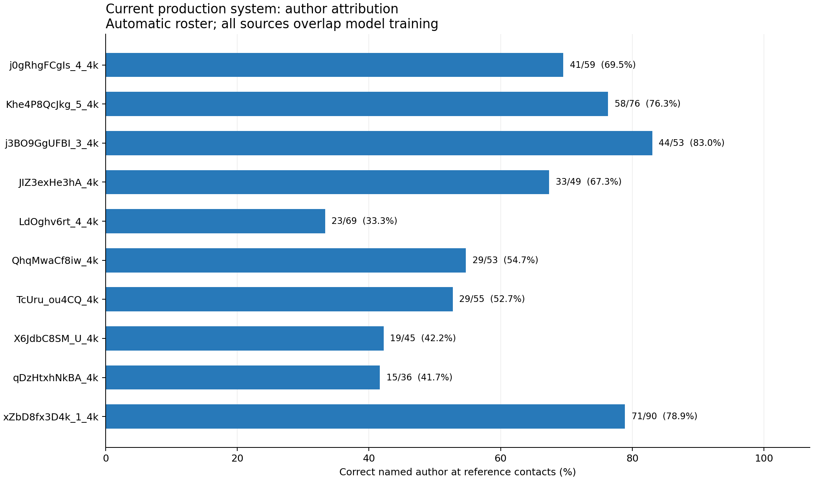

# Automatic-roster contact benchmark — 2026-11-14

At measured commit `5bd1d8af7b037b31bc0d18eb5dfd17d625476451`, the automatic
pipeline correctly named 362/585 reviewed person contacts: **61.88% recall**,
**71.68% precision**, **66.42% F1**. Person-level statistics need human review.
Performance varies from 33.33% to 83.02% recall across the ten sources.

These are **development-data measurements**. All ten sources trained the
final-fit contact-author model; the three exhaustive gold sources also trained
the contact spotter. This report does not estimate unseen-match accuracy.

The [aggregate JSON](current_contact_system_benchmark_20261114_v1.json) contains
counts, source/model fingerprints, the protocol and per-source measurements.

## Frozen inputs and inference

- Human export: `human_contact_author_dataset_v1`, source revisions 421 and 862.
- Snapshot SHA-256:
  `68796849cbaf3070f7c7c54de397d2176c2a0bf5d5746b725bb1cd255b820cf1`.
- Ten complete videos, 1,137 eligible author decisions: 585 named near-side
  people and 552 `other_team` contacts. Opponents have no individual-ID targets.
- Production ball detector at 1920, YOLO11m-pose at 2560, automatic
  `osnet_tracklet_roster_v5`, substitutions, contact spotting and current author
  eligibility guards. Author method: `osnet_temporal_all_sides_soft_hgb_v1`.
- Existing camera calibrations were frozen per source; net recalibration and
  rendered MP4 output were disabled. Reconstruction remained at default `off`.
- Compatible model-output caches were reused. Only missing stages were
  captured. Exact LF/CRLF-only backend equivalence was audited with identical
  weights, runtime and inference settings; original cache provenance remained
  available in the local logs.

There was no training, model selection, dataset refresh or production-code
change. Automatic inference did not read human contact-author decisions or
confirmed human photo rosters. New paired analyses were written separately.

## Evaluation protocol

Automatic and human P numbers are separate, video-local namespaces. Evaluation
names automatic identities through a one-to-one match to confirmed reference
boxes and frozen photo embeddings. Contact-author answers never choose this
mapping. Unambiguous same-frame box overlap supplies primary votes; a confident
setup-photo match can resolve a later ID hijack. Unmapped IDs count as errors.
Naming evidence is retained per source in the local run.

The initial scoring revision rejected a clearly named setup identity when a
later substitute reference carried its hijacked ID. Revision 2 fixes only that
evaluation naming: the original setup photo retains its person's name, while
later identity switches remain errors. Model labels and contact evidence did
not change; repeated numeric scores differed by at most `3.34e-16`.

The conditional author control supplies the reference event frame and type to
the current author runtime, retaining fresh automatic identities and saved
ball/pose observations. Unsupported types and abstentions are errors. This
changes event context, so it is not a mathematical upper bound for the complete
pipeline.

Timestamp comparison uses fixed tolerances of +/-5, +/-10 and +/-15 source
frames. Pairing maximizes one-to-one temporal matches, then minimizes timestamp
error. Author values never choose event pairs. Wrong people count as both a
false person prediction and a missed correct-person event.

## Author at a reference contact: all ten sources

| Metric | Result |
|---|---:|
| Exact person recall | 362/585 = **61.88%** |
| Exact person precision | 362/505 = **71.68%** |
| Person F1 | **66.42%** |
| Macro F1 across video-local people | 59.25% |
| Author or `other_team` accuracy | 889/1,137 = 78.19% |
| `other_team` recall | 527/552 = 95.47% |
| Person recall outside +/-60 frames of every human reference photo | 351/565 = 62.12% |

Person precision includes false person assignments on the 552 other-team
contacts. The 78.19% mixed-label accuracy is not individual-player accuracy.

Of 585 named targets, 362 were correct, 88 named another mapped person, 42 had
no confirmed automatic-to-human ID naming, 78 were unresolved and 15 were
assigned to the other team. The 42 unmapped cases are counted conservatively:
this is strict confirmed-ID attribution, not pure physical-actor localization.

| Source video | Named targets | Correct author | Recall |
|---|---:|---:|---:|
| `j0gRhgFCgIs_4_4k` | 59 | 41 | 69.49% |
| `Khe4P8QcJkg_5_4k` | 76 | 58 | 76.32% |
| `j3BO9GgUFBI_3_4k` | 53 | 44 | 83.02% |
| `JIZ3exHe3hA_4k` | 49 | 33 | 67.35% |
| `LdOghv6rt_4_4k` | 69 | 23 | 33.33% |
| `QhqMwaCf8iw_4k` | 53 | 29 | 54.72% |
| `TcUru_ou4CQ_4k` | 55 | 29 | 52.73% |
| `X6JdbC8SM_U_4k` | 45 | 19 | 42.22% |
| `qDzHtxhNkBA_4k` | 36 | 15 | 41.67% |
| `xZbD8fx3D4k_1_4k` | 90 | 71 | 78.89% |
| **Total** | **585** | **362** | **61.88%** |

## Contact detection and exact person: three exhaustive sources

Only `j0gRhgFCgIs_4_4k`, `Khe4P8QcJkg_5_4k` and `j3BO9GgUFBI_3_4k`
support exhaustive detection scoring here. The queue supplies 397 audited
contact times. Author-unsure contacts remain detection targets; their matched
predictions are excluded from person scoring. Unmatched predictions near
unaudited contact times are ignored explicitly.

| Task, +/-5 frames (about 167 ms) | TP | FP | FN | Precision | Recall | F1 |
|---|---:|---:|---:|---:|---:|---:|
| Contact, regardless of author/type | 390 | 7 | 7 | 98.24% | 98.24% | 98.24% |
| Contact plus exact named person | 140 | 28 | 48 | 83.33% | 74.47% | 78.65% |

The measured counts are unchanged at +/-10 and +/-15 frames. Removing human
`non_game` frames also leaves these counts unchanged in this run. That removal
is an explicitly human-phase diagnostic, not an automatic phase detector.
These three videos trained the spotter, so the high contact F1 is not a
held-out detection result.

Across all ten sources, 342/585 named targets (58.46%) were recovered with the
correct ID within +/-5 frames of their stored reference time. This is a
selected-queue diagnostic: on the other seven sources, author verification did
not verify timing, most inherited event types or full-video contact coverage.
Exhaustive detection precision/F1 cannot be claimed for those seven sources.

## Verification and local audit trail

All ten analyses completed with learned author attribution. Paired stats and
annotation author reports matched; the frozen human export and checked model
SHA-256 pins remained unchanged. Timestamp matching passed 500 deterministic
adversarial/random cases plus duplicate/empty-set checks. A regression confirms
photo-only naming when a later reference reveals a hijacked automatic ID.

The machine-local run remains at
`results/contact_system_benchmark_20261114_v1/`. It contains `manifest.json`,
`ground_truth.json`, `validation.json`, `pipeline/<video>/`, exact command logs,
the run/scoring scripts, `scores_v2/<video>/id_mapping.json`, conditional
predictions, fixed-tolerance event comparisons, `metrics_v2.json`,
`per_contact_v2.csv`, `per_player_v2.csv`, and both error-review CSVs.
Those raw labels, photographs, videos, weights, caches and analyses remain
local; this report archives aggregate evidence and its provenance.

The earlier [photo-roster development folds](contact_expanded_training_20261106_v1.md)
and [promotion checks](contact_author_promotion_20261107_v1.md) use different
setup/evaluation conditions. Their 83.19% held-out person recall must not be
presented as the current automatic pipeline's quality.
